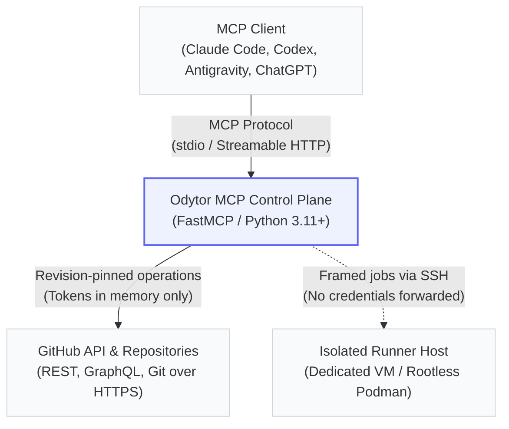

# OdyTor

**GitHub pull request operations, isolated validation, and guarded maintenance for AI agents.** Inspect large pull requests within bounded context windows, diagnose CI failures, explore and test changes in disposable Git-object workspaces, run headless browser checks in network-isolated containers, and prepare revision-pinned fixes with explicit human authorization gates.

A source-available project from [Anvilary Tools](https://anvilary.tools).

<p>
  <a href="https://www.python.org/downloads/"></a>
  <a href="https://modelcontextprotocol.io"></a>
  <a href="LICENSE"></a>
  <a href="https://anvilary.tools"></a>
</p>

---

## Why OdyTor?

AI coding assistants and maintainer agents often run into sharp operational limits when working directly with GitHub APIs and local developer checkouts: large pull request diffs overflow context budgets, multi-megabyte CI logs drown out root causes, concurrent pushes create silent race conditions, and running untrusted contributor code locally puts developer workstations and credentials at risk.

OdyTor is designed for repository maintainers, code-review agents, and automated engineering workflows that need repeatable, bounded, and auditable GitHub operations:

- **Bounded Pull Request Evidence**: Inspect large pull requests (`pr_evidence`) with paginated file lists, windowed diffs, review context, status checks, and explicit `*_complete` / `truncated_fields` signals.
- **Correlated CI Diagnosis**: Group failed workflow runs, job logs, step annotations, and code-scanning alerts (`ci_diagnose`) against pinned commit revisions.
- **Strict Revision Pinning & Branch Leases**: Require `expected_head` and `expected_base` SHAs across conflict checks, rebases, test runs, and mutations, refusing concurrent drift and enforcing `--force-with-lease` on fork pushes.
- **Checkout-Free Disposable Workspaces**: Explore, search, edit, diff, checkpoint, and test repositories in isolated Git object stores (`workspace_*`) without checking out working trees on the control plane.
- **Network-Isolated Runner Execution**: Execute tests (`test_run`, `workspace_run`), headless Chromium browser checks (`browser_run`), and multi-step validation campaigns (`validation_campaign`) inside rootless Podman containers with `--network=none`, `--cap-drop=ALL`, read-only root filesystems, and no GitHub credentials.
- **Four-State Capability Discovery**: Distinguish `installed`, `configured`, `operational` (observed via live runner probe), and `authorized` capabilities through `odytor_capabilities`.
- **Two-Phase Guarded Publication**: Prepare immutable plans (`publish_plan`, `pr_body_plan`) that require `user_authorized=true` and an exact confirmation phrase before applying (`publish_apply`, `pr_body_apply`), with server-side write gating disabled by default.

> [!NOTE]
> OdyTor complements the [official GitHub MCP server](https://github.com/github/github-mcp-server) rather than replacing it. The official server provides broad repository, issue, and search APIs; OdyTor focuses on agent-bounded PR evidence, CI log diagnosis, isolated validation, and lease-guarded Git operations.

---

## Quick Start

### Prerequisites

- **Python**: 3.11 or newer
- **Git**: 2.38 or newer (required for `git merge-tree` and object-store operations)
- **GitHub Credentials**: GitHub CLI (`gh`) authenticated with `repo` and `workflow` scopes, or a Personal Access Token via `GITHUB_TOKEN`

### 1. Install and Verify Locally

```bash
git clone https://github.com/Anvilary/Odytor.git
cd Odytor
python3 -m venv .venv
.venv/bin/pip install -e '.[dev]'

# Verify CLI and offline unit test suite
.venv/bin/odytor --version
.venv/bin/pytest -q
```

### 2. Run Over Local Stdio

**Direct stdio launch:**

```bash
export GITHUB_TOKEN="ghp_your_personal_access_token"
export ODYTOR_ALLOWED_REPOSITORIES="owner/repo,owner/another-repo"
.venv/bin/odytor --transport stdio
```

**Shared stdio launcher (`deploy/local/odytor-mcp`):**

OdyTor includes a stdio launcher script in [deploy/local/odytor-mcp](deploy/local/odytor-mcp) that resolves your active `gh` CLI token in memory without writing secrets to disk:

```bash
cp deploy/local/odytor-mcp ~/.local/bin/anvi-odytor-mcp
chmod +x ~/.local/bin/anvi-odytor-mcp
```

Example MCP client registration (`~/.claude.json`):

```json
{
  "mcpServers": {
    "anvi-odytor": {
      "command": "/path/to/your/.local/bin/anvi-odytor-mcp"
    }
  }
}
```

> [!TIP]
> In local stdio mode, leaving `ODYTOR_ALLOWED_REPOSITORIES` unset permits every repository visible to your GitHub credential and prints a notice to `stderr`. Always set an explicit allowlist in shared, automated, or hosted environments.

For remote Streamable HTTP hosting, GitHub OAuth, server-held PAT configuration, and reverse-proxy setup, see the [Deployment and Integration Guide](docs/deployment.md).

---

## Key Capabilities & Tool Catalog

OdyTor registers 31 MCP tools consistently across all deployment modes so client tool discovery stays predictable. Execution-backed tools return explicit setup instructions when no runner host is configured, and guarded write tools respect server configuration gates.

### Pull Request Evidence, Conflicts & Rebase

| Tool | Mode | Description |
| --- | --- | --- |
| [`pr_evidence`](docs/tools.md#pr_evidence) | Read-only | Collect PR metadata, windowed diffs, paginated file lists, reviews, and status checks with completeness flags. |
| [`ci_diagnose`](docs/tools.md#ci_diagnose) | Read-only | Correlate failed workflow runs, bounded job logs, annotations, and code scanning alerts against pinned revisions. |
| [`pr_conflicts`](docs/tools.md#pr_conflicts) | Read-only | Inspect merge conflicts via `git merge-tree` against the recorded base or live target-branch tip (`merge_target="live_tip"`). |
| [`pr_rebase_preview`](docs/tools.md#pr_rebase) | Read-only | Preview a linear rebase onto the live target branch tip without mutating branch refs. |
| [`pr_rebase`](docs/tools.md#pr_rebase) | Mutating | Preview or apply a linear rebase with `apply=true` and `allow_history_rewrite=true` confirmation guards. |
| [`quick_fix`](docs/tools.md#quick_fix) | Mutating | Validate an exact unified diff on regular non-executable UTF-8 files and append one commit with a lease. |
| [`ci_control`](docs/tools.md#ci_control) | Mutating | Trigger workflow reruns, failed-job reruns, dispatches, and fork workflow approvals with explicit authorization flags. |

### Disposable Engineering Workspaces

| Tool | Mode | Description |
| --- | --- | --- |
| [`workspace_create`](docs/workspaces.md) | Local state | Open a checkout-free Git-object workspace at `pr_head`, `prospective_merge`, or `branch` with an explicit operation scope. |
| [`workspace_read`](docs/workspaces.md) | Read-only | Inspect directory trees, bounded file line ranges, or Python/JS/TS symbol outlines. |
| [`workspace_search`](docs/workspaces.md) | Read-only | Search the exact workspace tree with `git grep` (literal by default, optional extended regex). |
| [`workspace_edit`](docs/workspaces.md) | Scratch only | Apply version-pinned (`expected_version`) `write`, `replace`, `delete`, `rename`, `patch`, `checkpoint`, and `reset` edits. |
| [`workspace_diff`](docs/workspaces.md) | Read-only | Return changed-file summaries, pageable patch windows, and the whole-patch SHA-256 digest. |
| [`workspace_list`](docs/workspaces.md) | Read-only | List active workspaces owned by the calling principal. |
| [`workspace_status`](docs/workspaces.md) | Read-only | Inspect current version, tree SHA, limits, expiry, and attached runs for a workspace. |
| [`workspace_manage`](docs/workspaces.md) | Local state | List, inspect, extend TTL, or close a disposable workspace. |

### Isolated Test Execution, Browser Evidence & Campaigns

| Tool | Mode | Description |
| --- | --- | --- |
| [`test_run`](docs/tools.md#test_run) | Execution | Queue an isolated test run against an exact PR head or prospective merge tree, with optional reviewer test overlays. |
| [`test_result`](docs/tools.md#test_result) | Read-only | Poll run progress, bounded live event streams, per-test structured outcomes, and currency checks. |
| [`test_run_list`](docs/tools.md#test_run_list) | Read-only | Recover previously submitted run IDs for a pinned PR head without starting a new run. |
| [`test_cancel`](docs/test-runner.md#cancellation) | Control | Cancel a queued or running job and tear down its runner container and workspace. |
| [`workspace_run`](docs/workspaces.md) | Execution | Execute an approved profile (`python-pytest`, `node-test`, etc.) against an immutable export of the workspace tree. |
| [`browser_run`](docs/browser.md) | Execution | Drive headless Chromium inside the isolated sandbox with typed steps, assertions, network evidence, and screenshots. |
| [`browser_close`](docs/browser.md) | Control | Close a replay-based browser session explicitly. |
| [`artifact_get`](docs/artifacts.md) | Read-only | Retrieve owner-bound screenshots (native MCP image content), logs, traces, and videos with SHA-256 provenance. |
| [`validation_campaign`](docs/tools.md#validation_campaign) | Execution | Run a bounded multi-profile and optional browser validation campaign on a PR head or prospective merge. |
| [`campaign_status`](docs/tools.md#validation_campaign) | Read-only | Poll status and child run summaries for an active or completed validation campaign. |
| [`campaign_cancel`](docs/tools.md#validation_campaign) | Control | Cancel a running validation campaign and its child runs. |

### Guarded Plan-Then-Apply Publication & Capability Discovery

| Tool | Mode | Description |
| --- | --- | --- |
| [`publish_plan`](docs/publishing.md) | Read-only | Prepare an immutable publication plan binding workspace tree, patch digest, expected head, validation evidence, and confirmation phrase. |
| [`publish_apply`](docs/publishing.md) | Mutating | Apply an approved `publish_plan` as one additive commit on the PR head after `user_authorized=true` and server gate checks. |
| [`pr_body_plan`](docs/publishing.md#draft-pr-body-updates-pr_body_plan--pr_body_apply) | Read-only | Prepare a body replacement plan for an open draft pull request, binding `expected_head` and body digests. |
| [`pr_body_apply`](docs/publishing.md#draft-pr-body-updates-pr_body_plan--pr_body_apply) | Mutating | Apply an approved `pr_body_plan` to a draft PR and verify post-write invariants via read-back. |
| `odytor_capabilities` | Read-only | Report version, build revision, limits, execution profiles, and per-capability `installed` / `configured` / `operational` / `authorized` state. |

### Registered Execution Profiles

Execution profiles are defined in trusted server/runner code (`odytor/profile.py`) and must be enabled per repository in the maintainer TOML policy (`ODYTOR_TEST_POLICIES`):

- **Primary verified profiles**: `python-pytest` (pinned maintainer requirements), `node-test` (`node --test --test-reporter=tap`), `browser-playwright` (headless Chromium against `127.0.0.1`), and `playwright-spec` (repository Playwright specs against an in-sandbox app).
- **Additional defined profiles**: `python-lint`, `python-typecheck`, `python-build`, `node-lint`, `node-typecheck`, `node-build`, `cmake-build`, `make-build`, and `c-test` (only operational when both enabled in repository policy and present in the pinned runner container image).

---

## Capability States & Operational Modes

OdyTor separates capability reporting into four explicit flags via `odytor_capabilities` so agents never confuse installed code with a live, authorized runtime:

| Flag | Meaning |
| --- | --- |
| `installed` | Code for the capability is present in this OdyTor build. |
| `configured` | Required operator settings (such as `ODYTOR_TEST_RUNNER_COMMAND`, `ODYTOR_TEST_POLICIES`, or `ODYTOR_WORKSPACE_ALLOW_PUBLISH_APPLY`) are set. |
| `operational` | Observed live via `odytor_capabilities(probe_runner=true)` (`true`, `false`, or `null` when not probed). |
| `authorized` | Permitted for the calling principal and repository policy. |

| Deployment Mode | PR & CI Tools (`pr_*`, `ci_*`, `quick_fix`) | Workspaces & Plan Tools (`workspace_*`, `*_plan`) | Runner Execution (`test_run`, `workspace_run`, `browser_run`, `validation_campaign`) |
| --- | --- | --- | --- |
| **Local stdio (no runner)** | Operational | Operational (unless `ODYTOR_WORKSPACES=off`) | Registered; returns runner configuration instructions |
| **Local stdio (with runner)** | Operational | Operational | Operational for policy-enabled profiles on the runner |
| **Hosted Streamable HTTP (with runner)** | Operational | Operational | Operational for policy-enabled profiles on the runner |

---

## Architecture & Security Model

OdyTor isolates MCP protocol handling, GitHub credentials, ephemeral Git workspaces, and untrusted repository code across distinct trust boundaries:



- **No In-Process Code Execution**: Repository code, test suites, build scripts, and Git hooks (`core.hooksPath=/dev/null`) are never executed in the MCP server process.
- **Credential Isolation**: GitHub tokens stay in memory and are passed to Git subprocesses via host-scoped authorization headers; the isolated runner never receives GitHub tokens or server secrets.
- **Rootless Sandbox Enforcement**: `odytor-runner` executes jobs inside rootless Podman containers with `--network=none`, `--read-only`, `--cap-drop=ALL`, `no-new-privileges`, unprivileged UID `65534`, and bounded memory/PID/tmpfs limits.
- **Fail-Closed Concurrency & Uncertainty Handling**: Stale SHAs or workspace versions fail closed; network ambiguities during mutations return `outcome: "unknown"` rather than retrying blindly, and `publish_apply` reconciles against the remote before retrying.

See [Security Model](docs/security.md) and [Pre-Release Security Review](docs/security-review.md) for detailed threat boundaries and test verification status.

---

## Configuration Overview

All settings use the `ODYTOR_` prefix and are parsed by `odytor/config.py`.

| Variable | Default | Purpose |
| --- | --- | --- |
| `ODYTOR_ALLOWED_REPOSITORIES` | `""` | Comma-separated allowlist (`owner/repo` or `owner/*`). |
| `ODYTOR_MAX_RESPONSE_BYTES` | `262144` (256 KiB) | Response budget before field truncation (16 KiB to 4 MiB). |
| `ODYTOR_GITHUB_TIMEOUT` | `120` | GitHub API read timeout in seconds (10 to 600). |
| `ODYTOR_WORKSPACES` | `on` | Set to `off` to disable disposable workspace tools. |
| `ODYTOR_WORKSPACE_DIR` | `$XDG_STATE_HOME/odytor/workspaces` | Persistent directory for workspace Git objects, sessions, and plans. |
| `ODYTOR_WORKSPACE_ALLOW_PUBLISH_APPLY` | `off` | Must be `on`/`true` to allow `publish_apply` and `pr_body_apply` writes. |
| `ODYTOR_ARTIFACTS` | `on` | Set to `off` to disable artifact storage. |
| `ODYTOR_ARTIFACT_DIR` | `$XDG_STATE_HOME/odytor/artifacts` | Storage directory for owner-bound screenshots, logs, and traces. |
| `ODYTOR_TEST_RUNNER_COMMAND` | `""` | JSON argv array for invoking `odytor-runner` over forced-command SSH. |
| `ODYTOR_TEST_POLICIES` | `""` | Path to maintainer TOML policy file enabling repositories and profiles. |
| `ODYTOR_TEST_DATA_DIR` | `$XDG_STATE_HOME/odytor/tests` | Spool directory for retained test run records. |
| `ODYTOR_PUBLIC_URL` | `""` | Canonical external HTTPS URL for OAuth metadata and callbacks. |
| `ODYTOR_ALLOWED_GITHUB_USERS` | `""` | Comma-separated GitHub logins permitted in OAuth mode. |
| `ODYTOR_AUTH_TOKEN` | `""` | Static bearer secret for non-OAuth Streamable HTTP deployments. |
| `ODYTOR_BUILD_REVISION` | unset | 7-to-40 hex commit SHA stamped into images for `odytor_capabilities`. |

For the complete configuration reference, limits, and environment variables, see [Deployment and Integration Guide](docs/deployment.md), [Workspaces](docs/workspaces.md), [Artifacts](docs/artifacts.md), and [Test Runner Architecture](docs/test-runner.md).

---

## Verification & Validation Tiers

OdyTor divides validation into three tiers:

1. **Tier 1 (Offline Unit & Git Fixture Suite)**: Runs without external runner images or network access; verifies tool schemas, allowlists, revision pinning, workspace locks, overlays, publication guards, and Git fixture workflows.
   ```bash
   .venv/bin/python -m compileall -q odytor
   .venv/bin/pytest -q -rs
   ```
2. **Tier 2 (Isolated Container & SSH Runner Integration)**: Exercises real rootless Podman containers (`ODYTOR_TEST_RUNNER_IMAGE`), real headless Chromium (`ODYTOR_TEST_BROWSER_IMAGE`), and provisioned KVM/SSH runner hosts (`ODYTOR_TEST_SSH_RUNNER_DIR`). Tests whose host prerequisites are absent skip explicitly with `-rs`.
3. **Tier 3 (Packaging & Transport Verification)**: Verifies clean wheel installation, CLI entry points (`odytor`, `odytor-runner`), and Streamable HTTP / OAuth metadata checks.

---

## Documentation Directory

- **[Tool Reference](docs/tools.md)**: Detailed schemas, windowing rules, and parameter guides for the core tools and additive catalog.
- **[Disposable Workspaces](docs/workspaces.md)**: Checkout-free Git object stores, versioned editing, confinement, and scope controls.
- **[Browser Execution](docs/browser.md)**: Typed Playwright steps, network isolation, replay sessions, and evidence rules.
- **[Artifacts](docs/artifacts.md)**: Owner-bound evidence storage, media sniffing, quotas, and native MCP image delivery.
- **[Guarded Publication](docs/publishing.md)**: Plan-then-apply invariants for workspace commits and draft PR bodies.
- **[Test Runner Architecture](docs/test-runner.md)**: Framed SSH protocol, container isolation, dependency cache, and provisioning.
- **[Security Model](docs/security.md)**: Core security invariants, revision guards, leases, and credential handling.
- **[Security Review](docs/security-review.md)**: Line-by-line pre-release assessment distinguishing verified tests, code reviews, and unverified areas.
- **[Capability Matrix](docs/capability-matrix.md)**: Feature status and test evidence across baseline and workspace expansion.
- **[Client Compatibility](docs/client-compatibility.md)**: Verified fastMCP behaviors, approval prompt layers, and untested product UIs.
- **[Deployment and Integration Guide](docs/deployment.md)**: Local stdio setup, Streamable HTTP, GitHub OAuth, and full settings reference.
- **[Migration from Git Plus](docs/migration-from-git-plus.md)**: Temporary compatibility aliases and upgrade notes.
- **[Security Policy](SECURITY.md)**: Vulnerability reporting instructions and supported version scope.
- **[Changelog](CHANGELOG.md)**: Release notes and boundaries for v1 (`0.1.0`).

---

## Known Boundaries & Intentional Limitations

- **No Pull Request Merge or Branch Deletion**: OdyTor does not provide tools to merge pull requests or delete remote branches.
- **No Thread Reading or Comment/Review Publishing**: Tools for reading conversation threads (`thread_read`) or publishing PR comments, review verdicts, replies, or issue/PR closures (`text_plan`, `text_apply`, `text_recover`) are excluded or deferred from this v1 candidate.
- **Guarded Publication Disabled by Default**: `publish_apply` and `pr_body_apply` refuse writes unless `ODYTOR_WORKSPACE_ALLOW_PUBLISH_APPLY=on` is explicitly configured by the server operator. Default workspace scopes exclude `publish`.
- **Draft-Only PR Body Updates**: `pr_body_plan` and `pr_body_apply` only accept open draft pull requests (`draft=true`) and refuse ready-for-review pull requests.
- **External Runner Required for Execution**: `test_run`, `workspace_run`, `browser_run`, and `validation_campaign` require an external runner host (`ODYTOR_TEST_RUNNER_COMMAND`) and repository entries in `ODYTOR_TEST_POLICIES`.
- **Maintainer-Pinned Dependencies**: Only `python-pytest` (and `playwright-spec` with approved Python requirements) builds a dependency environment from maintainer-pinned requirements; repository manifests are never trusted to install Node or Python packages dynamically.
- **Sandboxed Browser Scope**: `browser_run` drives headless Chromium against `127.0.0.1` inside the container only. Unrestricted JavaScript evaluation, external network access, file uploads/downloads, and Firefox/WebKit are intentionally unavailable.
- **Verification Scope**: Tier 1 offline unit/Git-fixture tests pass in CI and local development. Full SSH runner VM tests (`tests/test_ssh_runner.py`), real GitHub writes, CPU cgroup enforcement on hosts without CPU controller delegation, and external product UI rendering (ChatGPT, Perplexity, Claude Code UI) require target environment verification outside offline CI.

---

## Contributing

Contributions must be focused and accompanied by relevant test coverage. Before submitting changes, run the compilation and test checks:

```bash
.venv/bin/python -m compileall -q odytor
.venv/bin/pytest -q -rs
```

Guidelines:
- Preserve backward compatibility for existing MCP tool names and schemas.
- Adhere strictly to the security invariants in [docs/security.md](docs/security.md).
- Avoid em dashes in documentation and code comments.
- Never add AI attribution or `Co-Authored-By` trailers to commits or pull requests.

---

## License

OdyTor is distributed under the **[PolyForm Noncommercial License 1.0.0](LICENSE)**.

- **Noncommercial use permitted**: Free for research, personal study, hobby projects, amateur pursuits, education, and noncommercial organizations.
- **Commercial use restricted**: Commercial use or commercial deployment requires separate written permission from the rights holder. OdyTor is not OSI-approved open-source software.

Copyright (c) 2026 Alexandre Teixeira and Anvilary Tools contributors.

---

## Organization and Status

OdyTor is maintained by Alexandre Teixeira as part of [Anvilary Tools](https://anvilary.tools).

- **Distribution**: `odytor`
- **MCP Server Identifier**: `anvi-odytor` (`Odytor`)
- **Current Version**: `0.1.0`
