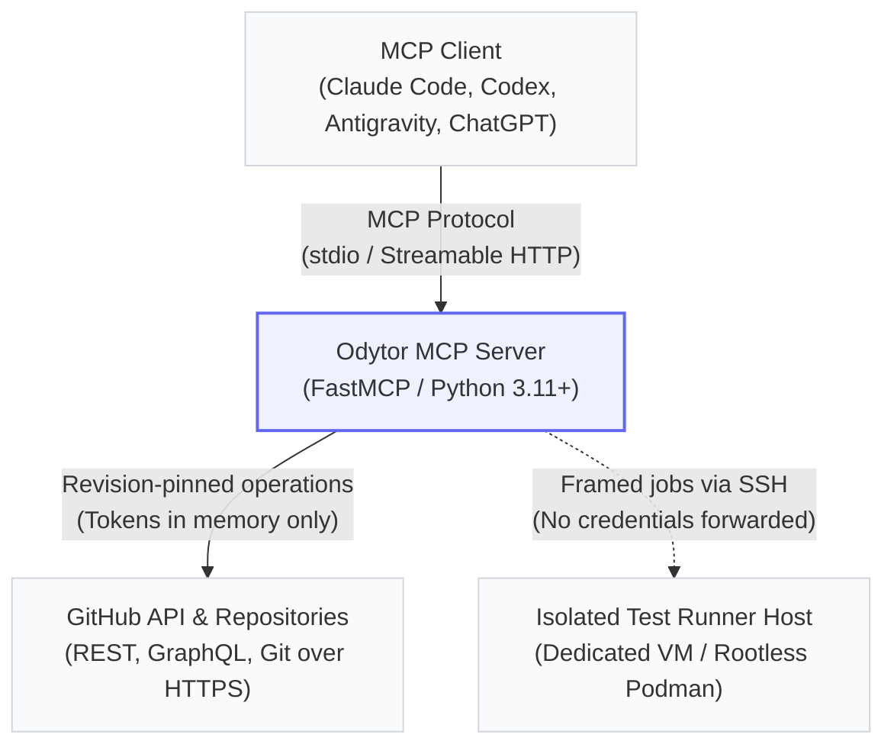

<p align="center">
  
</p>

<h1 align="center">Odytor</h1>

<p align="center">
  <strong>GitHub operations, optimized for AI agents.</strong>
</p>

<p align="center">
  An <a href="https://anvilary.tools">Anvilary Tools</a> project.
</p>

<p align="center">
  <a href="https://www.python.org/downloads/"></a>
  <a href="https://modelcontextprotocol.io"></a>
  <a href="LICENSE"></a>
  <a href="https://anvilary.tools"></a>
</p>

---

Odytor is a lightweight Model Context Protocol (MCP) server that provides repository maintenance and pull request operations designed specifically for AI agents.

AI agents often struggle with standard GitHub operations: large pull request diffs exhaust context windows, concurrent commits cause silent conflicts, multi-megabyte CI logs exceed memory budgets, and executing untrusted contributor code on local developer machines poses severe security risks.

Odytor solves these challenges through eight focused, unbranded MCP tools that enforce bounded responses, explicit commit revision pinning, lease-bound Git updates, and isolated test execution.

> [!NOTE]
> Odytor complements the [official GitHub MCP server](https://github.com/github/github-mcp-server) rather than replacing it. The official server provides broad browsing of repositories, issues, discussions, and search APIs. Odytor provides agent-optimized operations: windowed diffs, revision-pinned patches, linear rebases with leases, log diagnosis, and sandboxed test execution.

> Odytor was developed under the name Git Plus. Existing installations and configuration keys continue to function through compatibility aliases. See [docs/migration-from-git-plus.md](docs/migration-from-git-plus.md) for details.

---

## Capabilities

Odytor exposes eight original tools that form the stable MCP contract, plus tools for disposable engineering workspaces,
browser evidence, artifacts and guarded publication. The tool names of the original eight are unchanged.

| Tool | Mode | Description |
| --- | --- | --- |
| [`pr_evidence`](docs/tools.md#pr_evidence) | Read-only | Collect PR metadata, windowed diffs, file lists, reviews, and status checks with completeness flags. |
| [`ci_diagnose`](docs/tools.md#ci_diagnose) | Read-only | Correlate failed CI jobs, log excerpts, annotations, and code scanning alerts against captured revisions. |
| [`pr_conflicts`](docs/tools.md#pr_conflicts) | Read-only | Inspect Git merge conflicts via `git merge-tree` with conflict stages and text regions. |
| [`quick_fix`](docs/tools.md#quick_fix) | Mutating | Validate an exact patch in an isolated index and append one commit to the PR head with a lease. |
| [`pr_rebase`](docs/tools.md#pr_rebase) | Mutating | Preview or apply a linear rebase onto the live target branch with explicit confirmation guards. |
| [`ci_control`](docs/tools.md#ci_control) | Mutating | Coordinate revision-aware workflow reruns, failed job reruns, dispatches, and fork run approvals. |
| [`test_run`](docs/tools.md#test_run) | Execution | Queue an isolated pytest run against an exact PR head or merge tree, with optional reviewer test overlays. |
| [`test_result`](docs/tools.md#test_result) | Read-only | Retrieve per-test evidence, tested tree, overlay digest, and runner cache status. |

**Remote engineering workspace** (additive; see [Workspaces](docs/workspaces.md)):

| Tool | Mode | Description |
| --- | --- | --- |
| `odytor_capabilities` | Read-only | What this deployment can actually do: installed, configured, observed-operational and authorized, per capability. |
| `workspace_create` / `workspace_manage` | Local state | Open a disposable workspace at an exact PR head, prospective merge or branch revision; list, extend, close. |
| `workspace_read` / `workspace_search` / `workspace_diff` | Read-only | Tree, bounded file ranges, symbols, `git grep` and the complete effective diff. |
| `workspace_edit` | Scratch only | Versioned `write`, `replace`, `delete`, `rename`, `patch`, `checkpoint`, `reset`; GitHub is never touched. |
| `workspace_run` / `test_cancel` | Execution | Run `python-pytest` or `node-test` on the exact current tree; cancel queued or running work. |
| [`browser_run`](docs/browser.md) / `browser_close` | Execution | Chromium against the application in the sandbox; steps, assertions, network evidence, screenshots as native image content. |
| [`artifact_get`](docs/artifacts.md) | Read-only | Retrieve screenshots, logs and traces with provenance and integrity hashes. |
| [`publish_plan` / `publish_apply`](docs/publishing.md) | Plan read-only / apply mutating | Prepare, then (after explicit user authorization) append one additive commit built from a workspace. |

For complete parameter schemas, output fields, and windowing behavior, see the [Tool Reference](docs/tools.md).

### Operational Support by Deployment Mode

Every tool is registered in every deployment mode so MCP client tool discovery remains stable. Test execution, `workspace_run` and `browser_run` require an isolated runner host; workspace reading, searching, editing, diffing and capability discovery do not.

| Deployment Mode | Investigation & Fixes (`pr_*`, `ci_*`, `quick_fix`) | Test Execution (`test_run`, `test_result`) |
| --- | --- | --- |
| **Local stdio (no runner)** | Full operational support | Registered; returns runner configuration requirements |
| **Local stdio (with runner)** | Full operational support | Full operational support |
| **Hosted Streamable HTTP (with runner)** | Full operational support | Full operational support |

---

## Quick Start

### Prerequisites
- Python 3.11 or newer
- Git 2.38 or newer
- GitHub CLI (`gh`) or a Personal Access Token with `repo` and `workflow` scopes

### 1. Installation

Install Odytor in a dedicated virtual environment:

```bash
git clone https://github.com/Anvilary/Odytor.git
cd Odytor
python3 -m venv .venv
.venv/bin/pip install -e '.[dev]'
```

Verify the installation and test suite:

```bash
.venv/bin/odytor --version
.venv/bin/pytest -q
```

### 2. Configure MCP Client

Odytor includes a stdio launcher script in `deploy/local/odytor-mcp` that retrieves your GitHub CLI session token without writing credentials to disk.

Install the launcher:

```bash
cp deploy/local/odytor-mcp ~/.local/bin/anvi-odytor-mcp
chmod +x ~/.local/bin/anvi-odytor-mcp
```

Add Odytor to your agent profile:

**Claude Code (`~/.claude.json`):**
```json
{
  "mcpServers": {
    "anvi-odytor": {
      "command": "/home/YOUR_USER/.local/bin/anvi-odytor-mcp"
    }
  }
}
```

**Direct stdio invocation:**
```bash
export GITHUB_TOKEN="ghp_your_personal_access_token"
export ODYTOR_ALLOWED_REPOSITORIES="owner/repo,owner/another-repo"
.venv/bin/odytor --transport stdio
```

> [!TIP]
> In local stdio mode, Odytor defaults to unrestricted repository access if `ODYTOR_ALLOWED_REPOSITORIES` is not set, printing a plain-language notice to stderr. For production or automated setups, always configure an explicit allowlist.

For remote web deployment, Streamable HTTP, and ChatGPT integration, see the [Deployment Guide](docs/deployment.md).

---

## Architecture

Odytor maintains strict operational boundaries between MCP clients, the GitHub API, local Git workspaces, and execution sandboxes.



### Key Architectural Boundaries

- **MCP Client Boundary:** Standard JSON-RPC communication over stdio or Streamable HTTP. Tool schemas are unbranded and carry explicit annotations (`readOnlyHint`, `destructiveHint`).
- **Server and Ephemeral Workspaces:** Odytor executes Git operations inside temporary directories created with restricted filesystem permissions. Workspaces are purged immediately after each operation.
- **GitHub API and Network:** Authentication tokens are kept strictly in memory and injected into Git subprocesses only via host-scoped authorization headers. Tokens are never written to disk or logs.
- **Isolated Runner Boundary:** Odytor never executes repository code in the main MCP server process. Test execution delegates over SSH to a dedicated runner VM running rootless Podman containers with no network access (`--network=none`), no capabilities, and no credentials.

See [docs/test-runner.md](docs/test-runner.md) for detailed runner VM specifications.

---

## Security Model

Odytor is designed around defensive engineering principles for autonomous agent interactions:

- **Strict Revision Pinning:** Mutating operations require exact commit SHAs (`expected_head` and `expected_base`). Odytor fails closed if remote branches advance concurrently.
- **Repository Allowlists:** `ODYTOR_ALLOWED_REPOSITORIES` limits operations to explicitly approved repositories. Access to contributor forks is restricted to PR head branches referencing allowlisted base repositories.
- **Branch Leases:** Remote branch updates use explicit push leases (`--force-with-lease=<ref>:<expected_head>`). `quick_fix` proves mathematically that new commits are an exact single child of the expected head before pushing.
- **Destructive Operation Guards:** Potentially disruptive operations require explicit confirmation arguments (e.g., `allow_history_rewrite=true`, `authorize_dispatch_semantics=true`, `user_authorized_fork_approval=true`).
- **No In-Process Code Execution:** Repository build scripts, test suites, and hooks are never executed within the MCP server process.
- **Uncertainty Handling:** Network interruptions or verification timeouts report `outcome: "unknown"` and are never retried automatically, preventing duplicate commits or unintended workflow dispatches.

For a comprehensive explanation of security boundaries and threat mitigations, see the [Security Model](docs/security.md).

---

## Documentation and Resources

- **[Tool Reference](docs/tools.md)**: Exhaustive documentation for the original eight tools, parameters, schemas, and large PR windowing.
- **[Workspaces](docs/workspaces.md)**, **[Browser](docs/browser.md)**, **[Artifacts](docs/artifacts.md)**, **[Publishing](docs/publishing.md)**: the remote engineering workspace.
- **[Capability Matrix](docs/capability-matrix.md)**, **[Security Review](docs/security-review.md)**, **[Client Compatibility](docs/client-compatibility.md)**: what exists, what was verified, and what was not.
- **[Security Model](docs/security.md)**: Defense in depth, revision guards, branch lease mechanics, and isolation boundaries.
- **[Deployment and Integration](docs/deployment.md)**: Stdio configuration, Streamable HTTP setup, ChatGPT OAuth integration, and environment variables.
- **[Test Runner Architecture](docs/test-runner.md)**: Protocol specifications, container sandboxing, SSH forced command, and policy configuration.
- **[Private Hosting Operations](docs/private-deployment.md)**: Production runbook, rollback procedures, resource budgets, and dogfooding checklist.
- **[Migration from Git Plus](docs/migration-from-git-plus.md)**: Compatibility rules, environment variable mappings, and migration instructions.

---

## Validation Tiers

Odytor enforces a three-tier validation policy:

- **Tier 1 (Every Commit):** Offline unit and fixture test suite across supported Python runtimes (3.11, 3.12, and 3.13). Verifies schemas, allowlist logic, revision guards, and Git workspace mechanics without external dependencies.
- **Tier 2 (Pre-Deployment):** Integration tests against an active test runner VM using real Podman containers and SSH framing.
- **Tier 3 (Release Certification):** Clean wheel installation, Streamable HTTP and stdio transport verification, full OAuth discovery checks, and deployment rollback validation.

---

## Code Map

```text
odytor/
  server.py          # FastMCP server registration and allowlist middleware
  auth.py            # Credential resolution, OAuth provider, and token routing
  config.py          # Environment settings and configuration parsing
  github.py          # GitHub REST and GraphQL client with bounded retries
  git_workspace.py   # Ephemeral Git workspace management and lease execution
  pr_evidence.py     # Pull request evidence collection and diff windowing
  ci_diagnose.py     # CI failure correlation and log diagnostic extraction
  pr_conflicts.py    # git merge-tree conflict inspection
  quick_fix.py       # Patch validation, GraphQL commits, and fork fast-forward push
  pr_rebase.py       # Linear rebase preview and lease-guarded application
  ci_control.py      # Actions rerun, job rerun, dispatch, and fork approval
  run_tests.py       # Test run queuing and client-side orchestration
  jobs.py            # Local test job spool and lifecycle state
  overlay.py         # Reviewer test overlay validation and application
  profile.py         # Test profile resolution and requirements mapping
  pytest_report.py   # Structured pytest evidence parser
  sandbox.py         # odytor-runner isolated container execution engine
```

---

## Contributing

Contributions to Odytor must be focused and accompanied by relevant test coverage. Before submitting changes, verify that the complete test suite passes:

```bash
.venv/bin/pytest -q
```

Guidelines:
- Maintain backward compatibility for existing MCP client configurations.
- Never add AI attribution or Co-Authored-By trailers to commit messages or pull requests.
- Avoid em dashes in documentation and code comments.
- Adhere strictly to the established security invariants.

---

## License

Odytor is distributed under the [PolyForm Noncommercial License 1.0.0](LICENSE).

- **Noncommercial purposes permitted:** Free for research, personal study, hobby projects, amateur pursuits, education, and noncommercial organizations.
- **Commercial use restricted:** Commercial use or deployment requires separate written permission from the rights holder. Odytor is not OSI-approved open source software.

Copyright (c) 2026 Alexandre Teixeira and Anvilary Tools contributors.

---

## Organization and Status

Odytor is maintained by Alexandre Teixeira as part of [Anvilary Tools](https://anvilary.tools).

Canonical repository: `Anvilary/Odytor`
Distribution: `odytor`
MCP Server identifier: `anvi-odytor`
Current version: `0.1.0`
